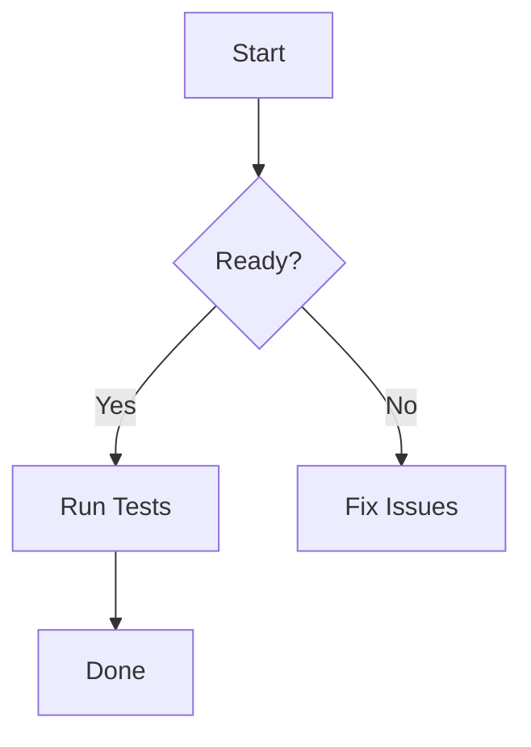

- add codebook spell checker
- review Typescript project/lsp
- rethink highlight / search matched result / selection visual design
- review markdown, reimpl?
  * mermaid: https://github.com/obsidianmd/pele?
- no support for hard click touchpad (lookup), add or put right click menu
- rethink cmd+J, terminal/central terminal behavior
- add webkit tab to render html?
- simplify setting, no need for SettingsObserver?
- There’s another config path I didn’t touch: the languages.<lang>.language_servers setting, which can still turn on servers registered as “available”. If you want server choice entirely in code, that would be a separate removal.

# mermaid test

