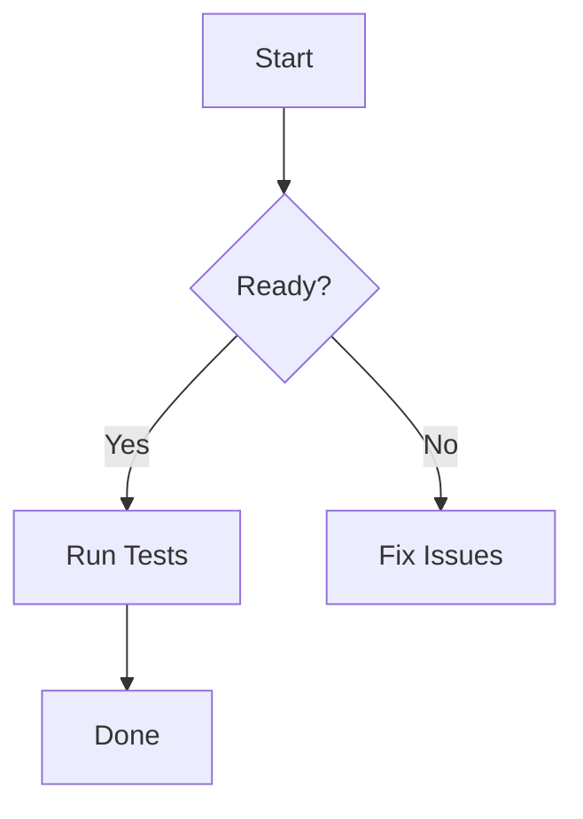

- add codebook spell checker
- remove direnv?
- review python venv, lsp handling
- review ts project/lsp
- rethink highlight / search matched result / selection visual design
- rethink scroller bar / minimap visual design
- mermaid: https://github.com/obsidianmd/pele?
- no support for hard click touchpad (lookup), add or put right click menu
- rethink cmd+J, terminal/central terminal behavior
- add webkit tab to render html?

# mermaid test

