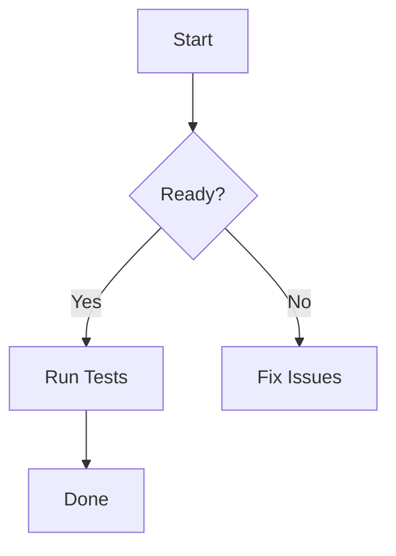

- review markdown, reimpl?
  * mermaid: https://github.com/obsidianmd/pele?
  * mermaid: no way to zoom now, delete this feature? (zoom (ctrl/cmd+scroll, reset))
- no support for hard click touchpad (lookup), add or put right click menu
- rethink cmd+J, terminal/central terminal behavior
- add webkit tab to render html?
- retire chrono
- think about keymap/shortcut key, only need simple ones (retire which_key), cmd+enter = expand window
- remove settingContent entirely? just hard code into code
- add workspace scoped UI settings, like title or border color, do i really need this? to distingish project
- add complete rust / clippy lint

# mermaid test

