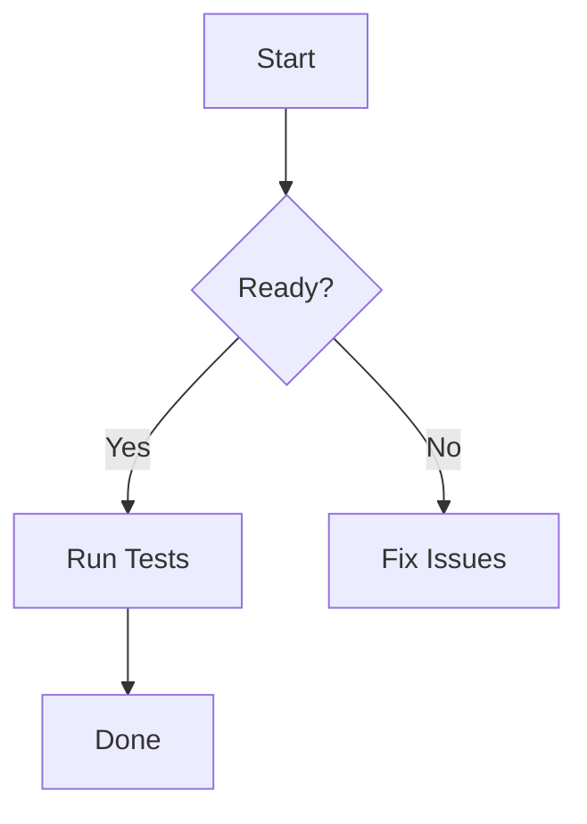

- add codebook spell checker
- rethink highlight / search matched result / selection visual design
- review markdown, reimpl?
  * mermaid: https://github.com/obsidianmd/pele?
- no support for hard click touchpad (lookup), add or put right click menu
- rethink cmd+J, terminal/central terminal behavior
- add webkit tab to render html?
- simplify setting, no need for SettingsObserver?
- retire chrono

# mermaid test

