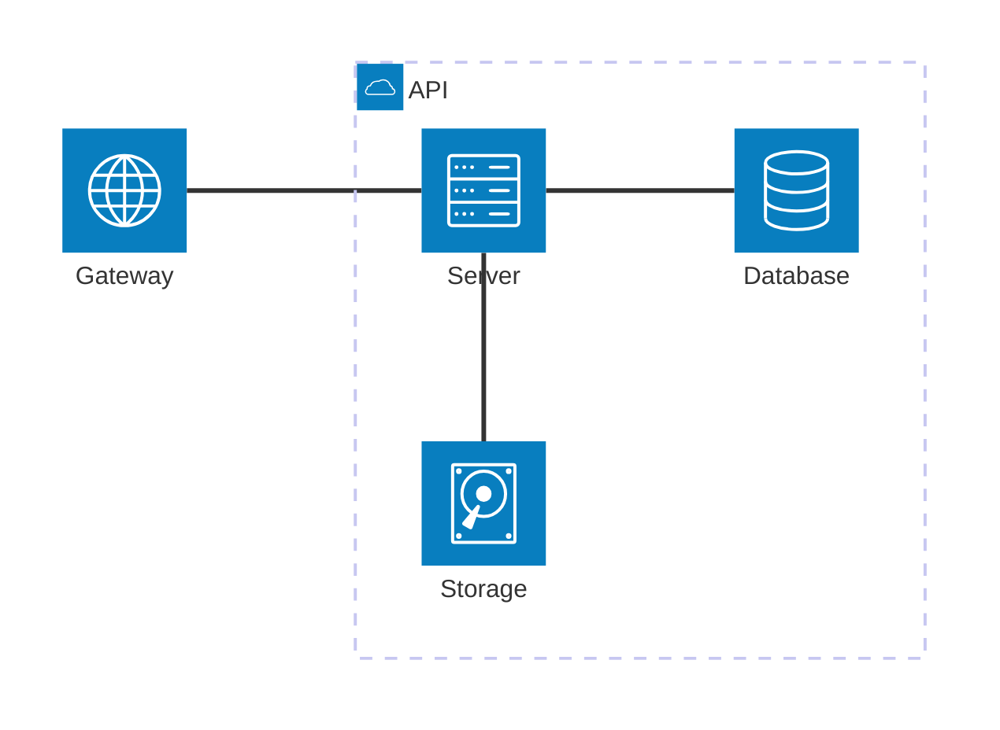
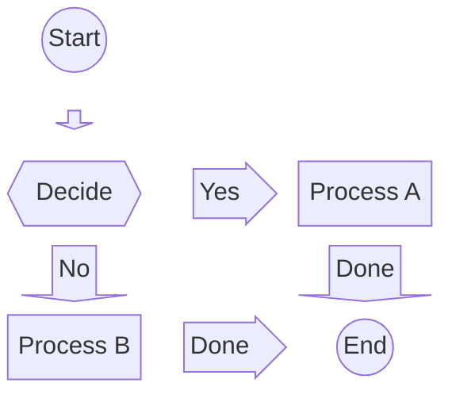
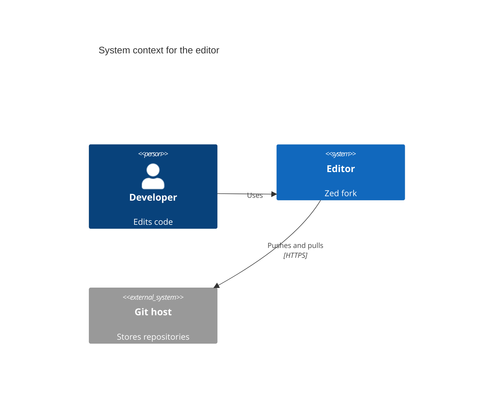
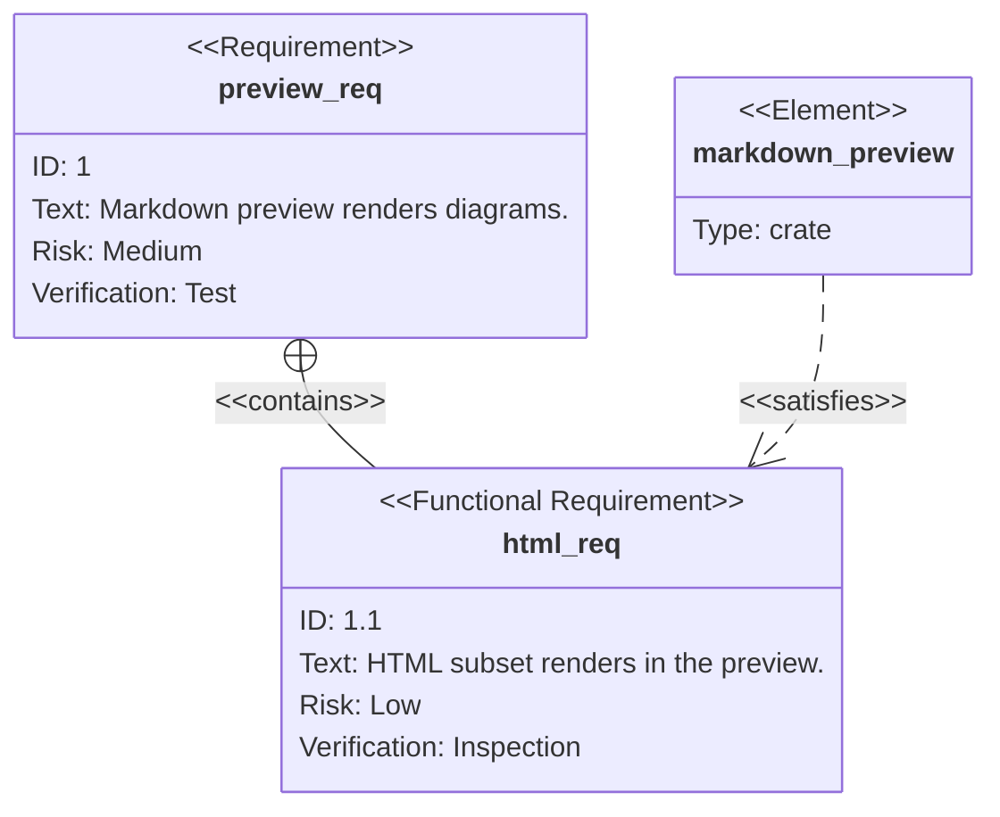
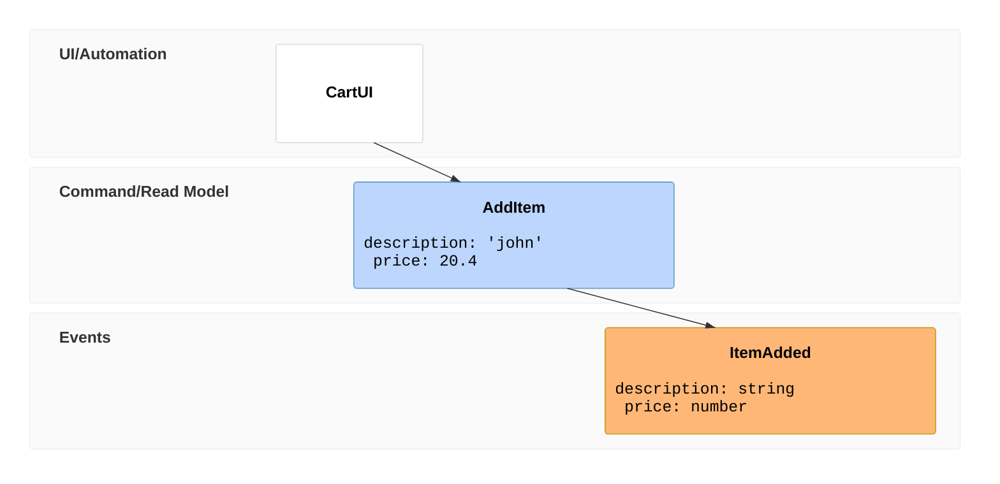

# Mermaid: architecture and modelling

Check each renders; icons that need an icon pack may show as plain boxes.

## Architecture



## Block



## C4 context



## Requirement



## Use case

```mermaid
usecase-beta
actor Developer
Preview("Open preview")
systemBoundary Editor
  Edit[Edit markdown]
end
Developer --> Preview
Developer --> Edit
```

## Swimlane

```mermaid
swimlane-beta LR
  subgraph Author
    write[Write doc]
    fix[Fix comments]
  end
  subgraph Reviewer
    read[Review]
    approve[Approve]
  end
  write --> read
  read -->|changes| fix
  fix --> read
  read --> approve
```

## Event modeling



## Agent flow

```mermaid
agentflow-beta TB
  flow reviewer["Review Agent"]
    changes["Gather changes"]@{ shape: input }
    analyse["Analyse diff"]@{ shape: task }
    lint["run_linter"]@{ shape: tool }
    ok["Clean?"]@{ shape: decision }

    changes --> analyse --> lint --> ok
  end
```
