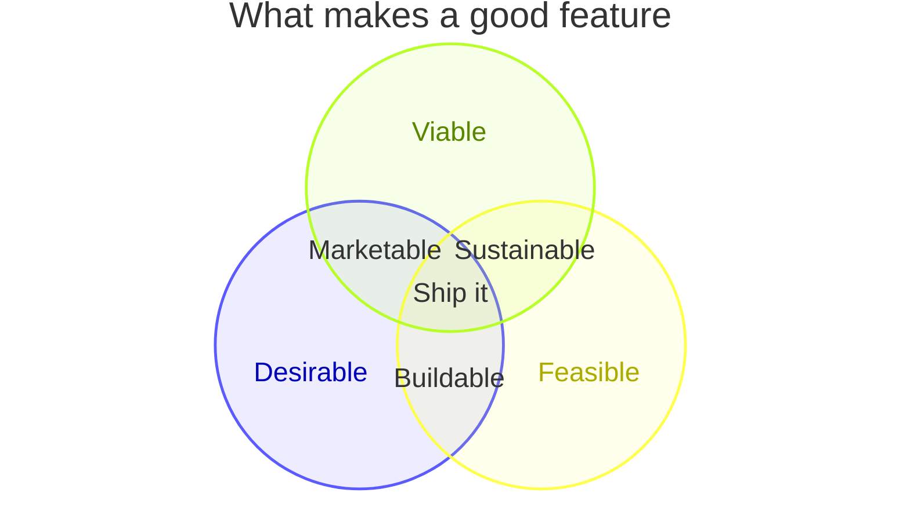
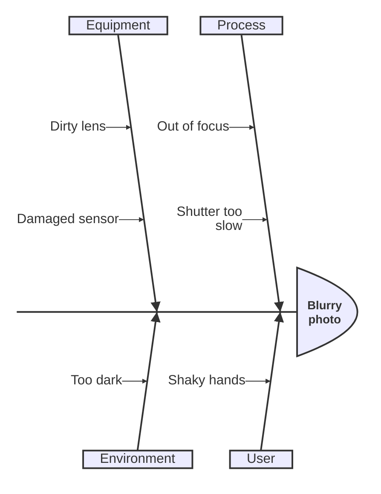

# Mermaid: less common diagrams

These are Ondine/Pele extensions or Mermaid betas. Check each renders.

## Venn



## Wardley map

```mermaid
wardley-beta
title Tea shop value chain

anchor Business [0.95, 0.63]
component Cup of Tea [0.79, 0.61]
component Tea [0.63, 0.81]
component Hot Water [0.52, 0.80]
component Kettle [0.43, 0.35]
component Power [0.10, 0.70]

Business -> Cup of Tea
Cup of Tea -> Tea
Cup of Tea -> Hot Water
Hot Water -> Kettle
Kettle -> Power

evolve Kettle 0.62
note "Standard power lets kettles evolve" [0.30, 0.49]
```

## Ishikawa (fishbone)



## Railroad

```mermaid
railroad-beta
title Expression grammar

expression = sequence(
    nonterminal("term"),
    zeroOrMore(sequence(
        choice(terminal("+"), terminal("-")),
        nonterminal("term")
    ))
) ;
term = oneOrMore(nonterminal("digit")) ;
```

## Cynefin

```mermaid
cynefin-beta
  title Strategy categorization

  complex
    "Market research"

  complicated
    "Competitive analysis"

  clear
    "Standard pricing"

  chaotic
    "Crisis management"

  complex --> complicated : "Pattern identified"
  chaotic --> complex : "Stabilized"
```

## Info

```mermaid
info
```
