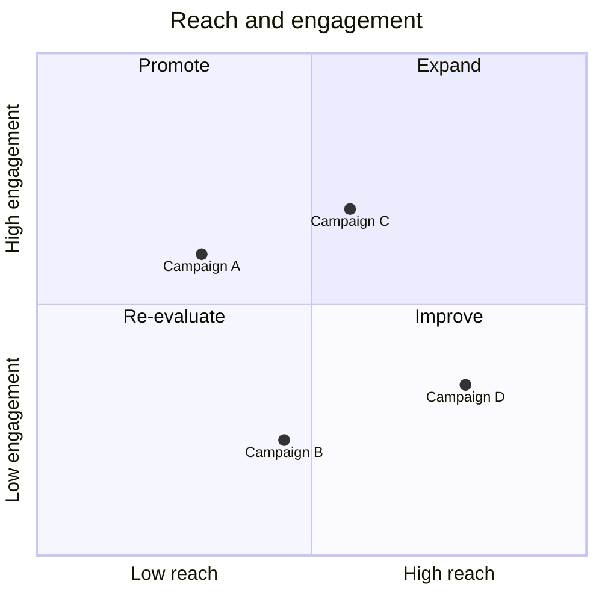
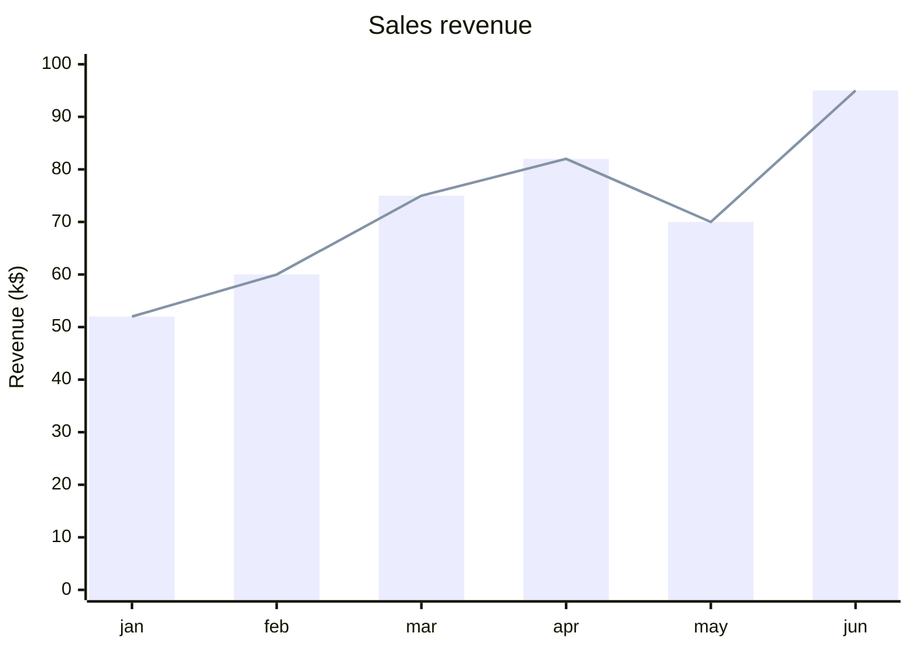
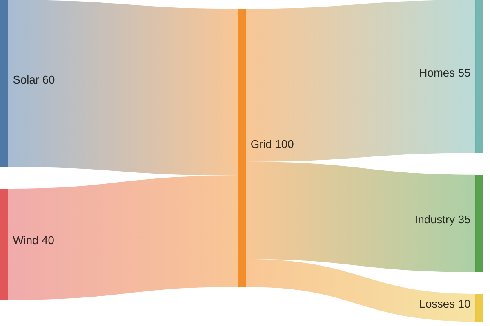
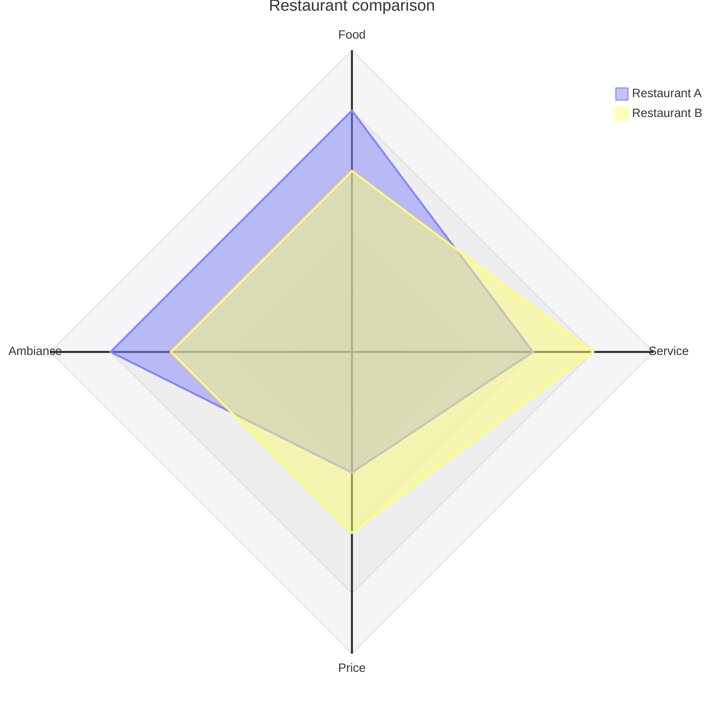
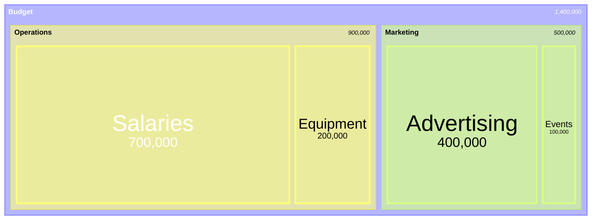
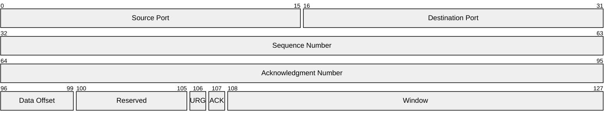
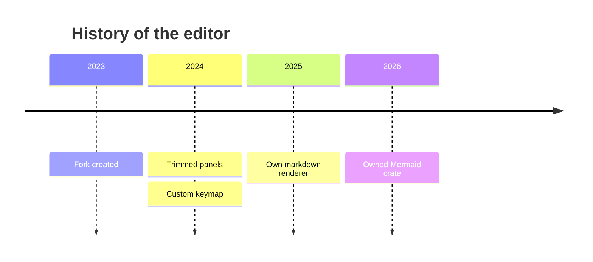
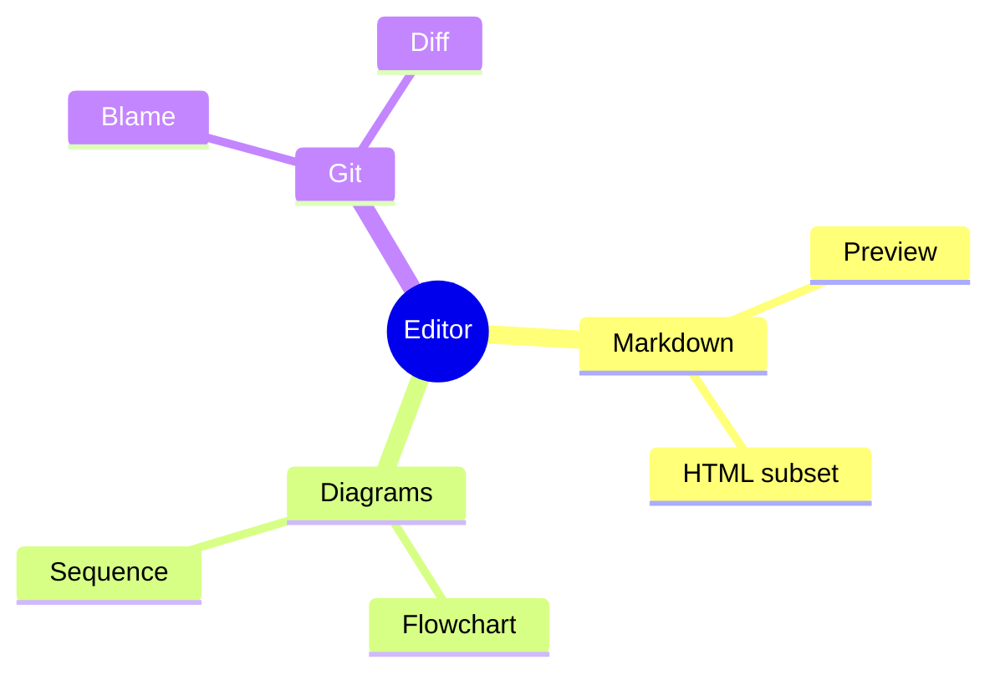
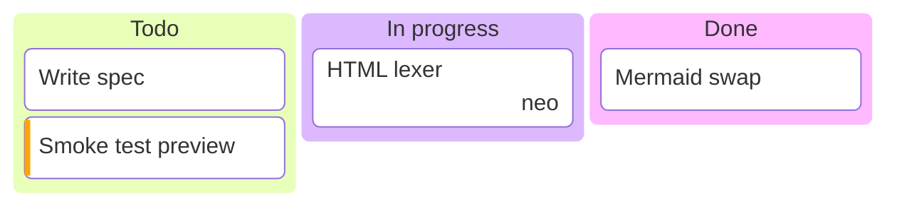

# Mermaid: charts and hierarchies

Check each renders, labels don't overlap badly, and colors follow the theme.

## Quadrant chart

## XY chart

## Sankey

## Radar

## Treemap

## Packet

## Timeline

## Mindmap

## Kanban

## Tree view

