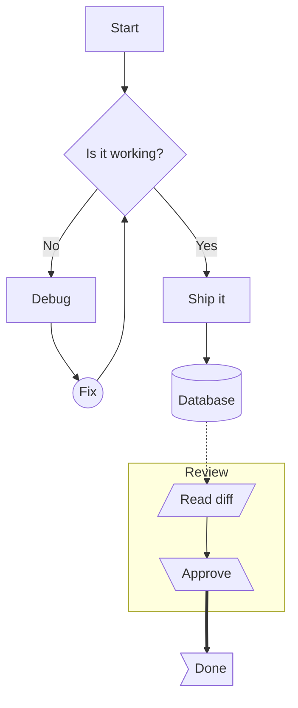
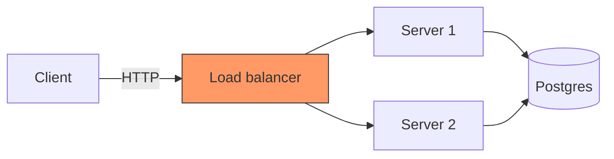
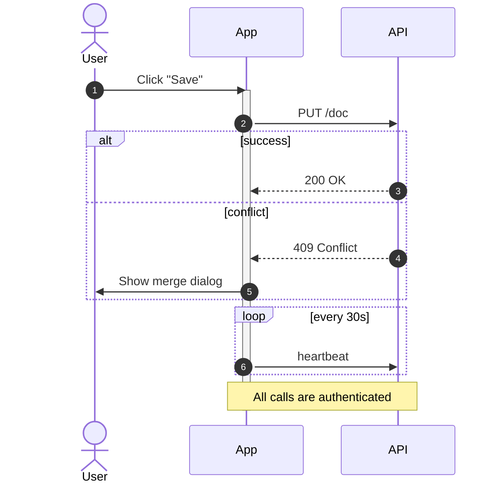
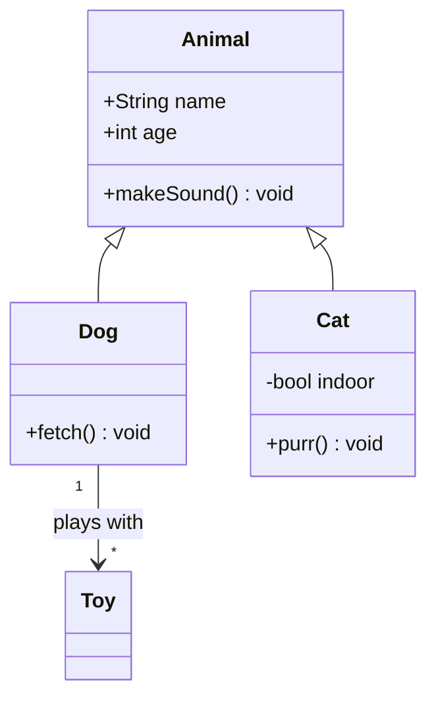
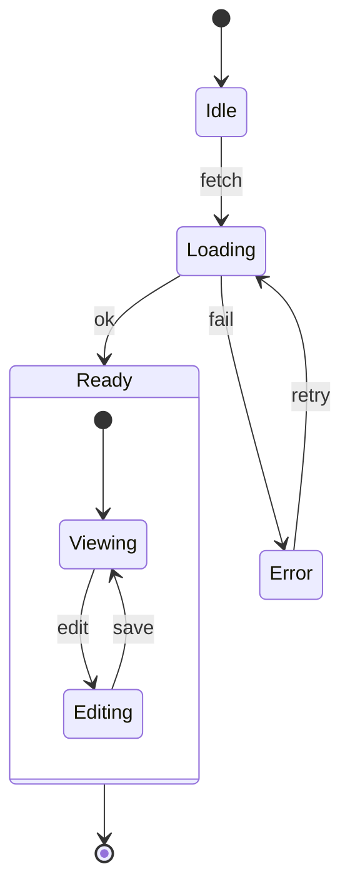
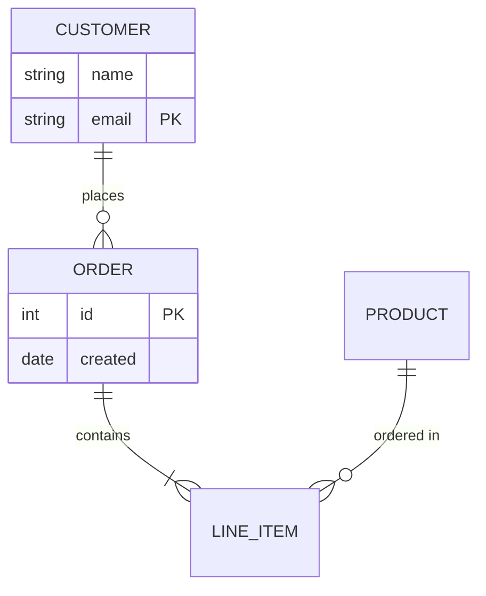
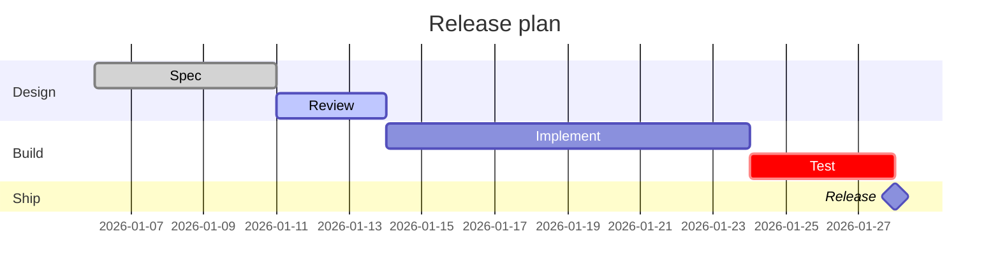
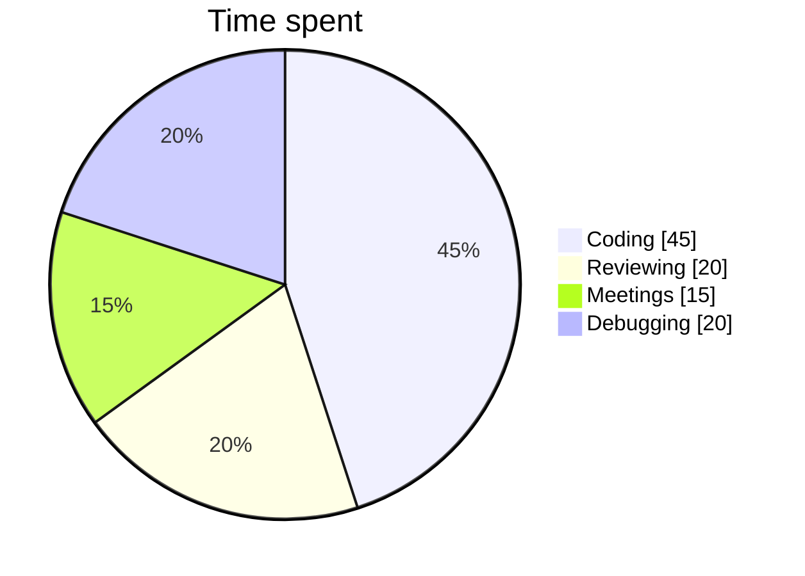
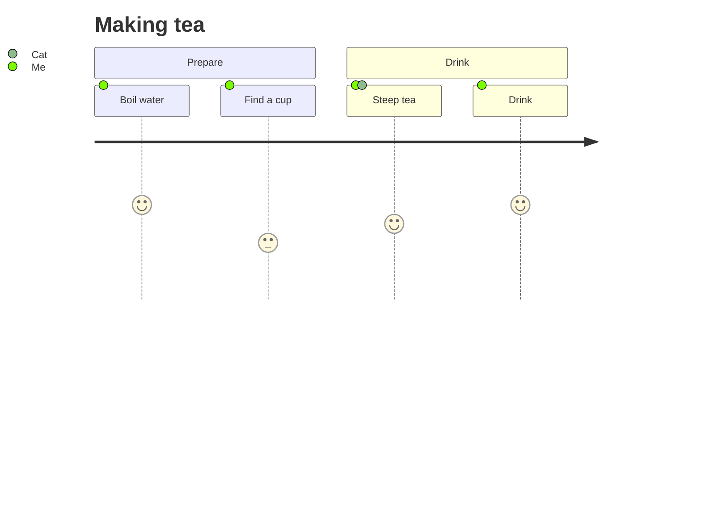
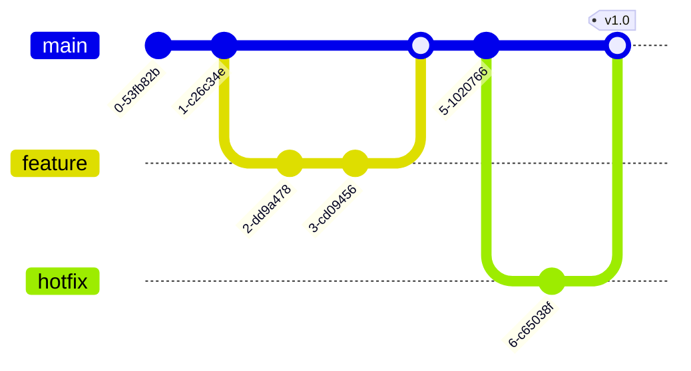

# Mermaid: core diagrams

Check each diagram renders (not an error box), text is legible in the
current theme, and switching theme (light ↔ dark) re-renders the colors.

## Flowchart

## Flowchart (left to right, `graph` keyword)

## Sequence

## Class

## State

## Entity relationship

## Gantt

## Pie

## User journey

## Git graph

