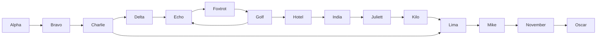
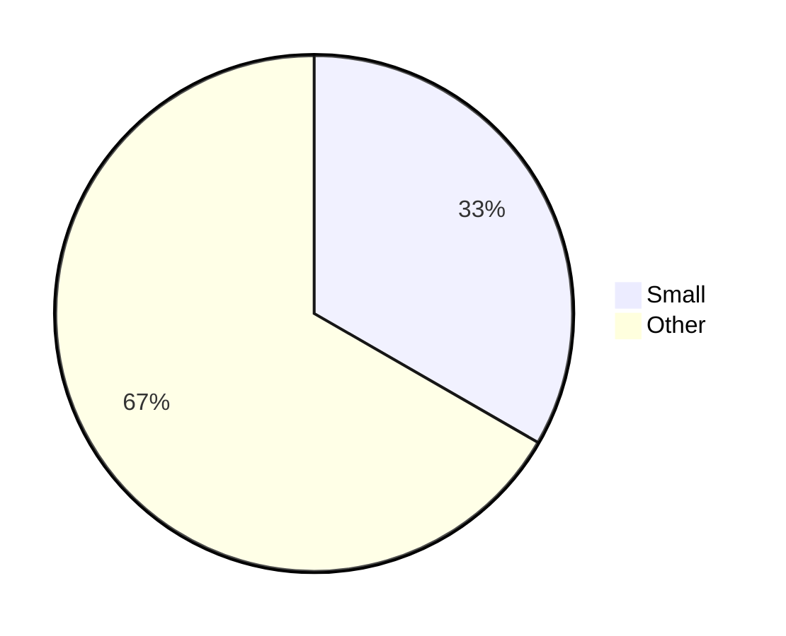
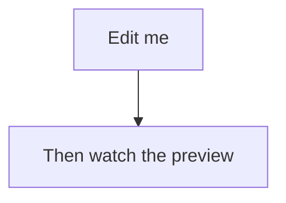
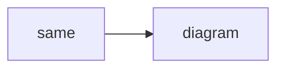

# Mermaid: interaction

## Wide diagram

In a narrow preview the diagram below overflows:
- It keeps its natural size and shows a horizontal scrollbar; horizontal
  swipes scroll it.
- Vertical scrolling over it scrolls the preview, and ctrl/cmd+scroll does
  nothing to the diagram (no per-diagram zoom).
- With the preview focused, cmd +/- grows/shrinks diagrams with the text and
  they stay crisp; cmd 0 restores them. No flash to code while re-rendering.





## Preview / Code tabs

Switch the diagram above to **Code**: the source shows with highlighting and a
copy button; switch back to **Preview**.

## Editing

Open this file side by side with its preview and edit the label below
(e.g. change `Edit me` to something longer). While it re-renders, the previous
image should stay visible (no flash to empty), then update.



## Invalid diagram

This should show an error (not crash, not an empty box), and the Code tab
should still show the source.

```mermaid
flowchart TD
    A --> --> B[unclosed
```

## Not mermaid

A plain code block next to a diagram: copy button on hover, Rust highlighting.

```rust
fn main() {
    println!("not a diagram");
}
```

## Duplicate diagrams

Two identical diagrams (shared cache): both render.




## Unclosed fence

The fence below is never closed: it should render as a plain code block, not a
diagram, until you close it.

```mermaid
graph TD
    open --> fence
